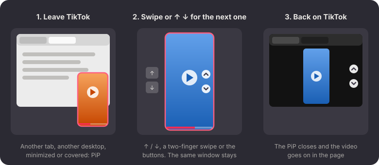

<p align="center"></p>

<h1 align="center">TikTok PiP for Firefox</h1>

<p align="center">TikTok follows you in picture-in-picture: it pops out when you leave the tab,<br>
switches videos with ↑ ↓, and goes back into the page when you return.</p>

<p align="center"></p>

## The problem

Firefox's picture-in-picture is made for one long video. TikTok is a feed of short ones, each
with its own player, so it doesn't fit:

- you have to open it by hand every time;
- it stops when TikTok moves on to the next video;
- there's no way to move to the next video from the picture-in-picture window.

TikTok also pauses as soon as its tab is hidden.

## What it does

- **Pops out by itself.** When the TikTok tab stops showing, the playing video goes to
  picture-in-picture. That happens when you:
  - switch to another tab;
  - minimize Firefox;
  - move to another desktop;
  - cover Firefox with another window.

  A paused video stays put, and the PiP window never takes your keyboard focus.
- **One window that stays.** Moving between tabs and desktops keeps the same window. It never
  closes and reopens.
- **↑ ↓ to switch videos.** Click the window, then press ↓ for the next video and ↑ for the
  previous one, as on TikTok itself. Or use the ▲ ▼ buttons that appear on hover. The window
  follows to the new video, and the TikTok tab moves along with it. ← → still jump 5 seconds.
- **Back to the page.** Select the TikTok tab again and the window closes, while the video keeps
  playing in the page.

Some details:
- Closing the window with ✕ pauses the video, as usual, so nothing pops up again until you
  press play.
- A picture-in-picture you open yourself while watching stays open until you've left TikTok and
  come back.
- Other sites aren't affected.

On GNOME, pair it with [PiP Everywhere](https://github.com/aimanelahssini/gnome-pip-everywhere).
It keeps the window on top on every desktop and skips the zoom-in, so the video is just there.

## Install

Needs Firefox from your distribution's package (`/usr/lib64/firefox` or `/usr/lib/firefox`;
not the Flatpak or Snap). Tested with Firefox 158.

```bash
git clone https://github.com/aimanelahssini/firefox-tiktok-pip
cd firefox-tiktok-pip
./install.sh
```

It asks for your password, because the files go into Firefox's own folder. Then restart Firefox.
Running `./install.sh` again after a `git pull` updates it, and asks for the password only if
something changed.

## How it works

Firefox runs a file called `mozilla.cfg` from its folder at startup ("autoconfig"). The installer
puts `tiktok-pip/` into Firefox's `autoconfig.d/` folder and adds a small loader to
`mozilla.cfg`. A `mozilla.cfg` from someone else is never changed. The code then uses Firefox's
own picture-in-picture: the parts that open, close and redraw the window. Package updates leave
these files alone.

Nothing is sent anywhere, and it never reads or changes your TikTok account. It only clicks
TikTok's own previous/next buttons.

TikTok changes its site from time to time. If ↑ ↓ stop working, please open an issue.

## Uninstall

```bash
./uninstall.sh
```

Then restart Firefox.

## Tests

- `node tests/tiktok-pip.test.mjs`: 30 checks on a private copy of the system Firefox (a btrfs
  reflink, so it costs no space), against a stand-in for TikTok's feed.
- `tests/desktops.sh`: other desktops and covering windows, in a throwaway headless GNOME Shell.
- `tests/install.test.sh`: the installer, on fake Firefox folders.

The tests need `node`, `ffmpeg` and, for `desktops.sh`, GNOME Shell.

## License

MIT
